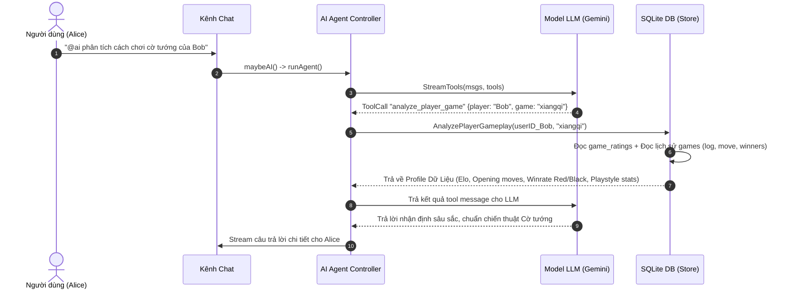

# Đặc Tả Kỹ Thuật (SPEC): AI Agents Phân Tích Lối Chơi & Chiến Thuật Từng Người Theo Game

- **Mã tính năng**: `AI-GAMEPLAY-ANALYTICS`
- **Tác giả**: Antigravity (DeepMind Team)
- **Trạng thái**: ✅ Hoàn thành / Ready for Production
- **Ngày tạo**: 2026-11-20
- **Thư mục liên quan**:
  - Backend: `controller/ai_agent.go`, `controller/ai.go`, `store/games.go`, `game/`
  - Database: `games`, `game_ratings`, `users`, `messages`

---

## 1. Mục Tiêu & Phạm Vi (Goals & Scope)

### 1.1 Mục tiêu (Goals)
1. **Truy vấn dữ liệu sâu từ CSDL (`chat.db`)**:
   - Cho phép AI Agent tự động đọc dữ liệu lịch sử các ván đấu đã kết thúc (`games`), điểm Elo & chuỗi thắng/thua (`game_ratings`), và log từng nước đi (`base.log`).
2. **Cung cấp Tool Chuyên Dụng Cho AI Agent (`analyze_player_game`)**:
   - Bổ sung tool `analyze_player_game` vào bộ công cụ `agentTools()` của Trợ lý AI `@ai`.
   - Nhận diện người chơi theo `@username` hoặc tên hiển thị, kèm môn game cần phân tích (`xiangqi`, `chess`, `caro`, `rps`, `werewolf`, `station`, hoặc `all`).
3. **Phân tích chiến thuật đặc thù cho từng trò chơi**:
   - Không trả lời chung chung; mỗi trò chơi có logic phân tích và chiến thuật riêng:
     - **Cờ Tướng (`xiangqi`)**: Khai cuộc sở trường (Pháo đầu, Bình phong mã, Khởi mã...), tỷ lệ thắng khi đi Tiên (Đỏ) vs Đi Hậu (Đen), phong cách công sát dồn dập hay thủ thế phản công, cách kết liễu (Chiếu bí vs Bức tử).
     - **Cờ Vua (`chess`)**: Nước mở cờ (e4, d4, Nf3, c4...), nhập thành, xu hướng tàn cuộc, khả năng tận dụng ưu thế quân.
     - **Cờ Caro (`caro`)**: Số nước trung bình để kết liễu, chiến thuật giăng bẫy 3-3/4-3 hay đánh phòng ngự bóp nghẹt, tỷ lệ thắng khi cầm X (đi trước) vs O.
     - **Oẳn Tù Tì (`rps`)**: Thói quen tâm lý ra tay (tỷ lệ Búa/Kéo/Bao), hành vi sau khi thắng/thua (Win-Stay, Lose-Shift).
     - **Ma Sói (`werewolf`)**: Tỷ lệ thắng theo phe Dân Làng vs phe Sói, phong cách biện hộ và độ chuẩn xác khi bỏ phiếu.
     - **Trạm Vũ Trụ (`station`)**: Tỷ lệ làm Kẻ phản bội thắng vs Thuyền viên thắng, phong cách di chuyển và phá hoại.
4. **Hồ sơ kỳ thủ & Khắc chế (Tactical Profile & Counter-Strategy)**:
   - Trả lời bao gồm:
     - Điểm Elo, cấp bậc Rank Tier hiện tại, đỉnh cao (Peak Rating).
     - Hình tượng phong cách (Playstyle Archetype): *Chiến tướng công sát*, *Bậc thầy phản kích*, *Kỳ thủ thực dụng*, *Cáo già tâm lý*...
     - Điểm mạnh và Điểm yếu / Tử huyệt.
     - Lời khuyên chiến thuật cụ thể để khắc chế kỳ thủ này khi đối đầu.

### 1.2 Không thuộc phạm vi (Non-Goals)
- Không can thiệp vào động cơ luật chơi của game (chỉ phân tích dữ liệu lịch sử).
- Không chia sẻ thông tin bí mật của các ván game đang diễn ra (chỉ đọc các ván `status == 'ended'`).

---

## 2. Kiến Trúc & Luồng Hoạt Động (Architecture & Flow)

### 2.1 Luồng Tương Tác Của AI Agent (Sequence Diagram)



---

## 3. Đặc Tả Tool `analyze_player_game` & API Contracts

### 3.1 Định Nghĩa Tool Trong `controller/ai_agent.go`

```json
{
  "name": "analyze_player_game",
  "description": "Phân tích lối chơi, chiến thuật, khai cuộc, điểm mạnh, điểm yếu và thành tích của một kỳ thủ/người chơi từ cơ sở dữ liệu cho một trò chơi cụ thể (xiangqi, chess, caro, rps, werewolf, station) hoặc toàn bộ game. Dùng khi có người hỏi về phong cách chơi, cách đối phó, hoặc phân tích kỹ năng của ai đó.",
  "parameters": {
    "type": "object",
    "properties": {
      "player": {
        "type": "string",
        "description": "Tên hiển thị hoặc @username của người cần phân tích."
      },
      "game": {
        "type": "string",
        "enum": ["xiangqi", "chess", "caro", "rps", "werewolf", "station", "all"],
        "description": "Loại trò chơi cần phân tích (mặc định: game người đó chơi nhiều nhất hoặc xiangqi/caro)."
      }
    },
    "required": ["player"]
  }
}
```

### 3.2 Cấu Trúc Dữ Liệu Trả Về Của Tool

```go
type PlayerGameAnalysis struct {
    UserID          int64              `json:"user_id"`
    PlayerName      string             `json:"player_name"`
    Username        string             `json:"username"`
    GameKind        string             `json:"game_kind"`
    Rating          int                `json:"rating"`
    PeakRating      int                `json:"peak_rating"`
    RankTier        string             `json:"rank_tier"`
    TierBadge       string             `json:"tier_badge"`
    TotalGames      int                `json:"total_games"`
    Wins            int                `json:"wins"`
    Losses          int                `json:"losses"`
    Draws           int                `json:"draws"`
    WinRate         float64            `json:"win_rate"`
    CurrentStreak   int                `json:"current_streak"`
    FirstTurnWins   int                `json:"first_turn_wins"`   // Thắng khi đi trước (Đỏ / Trắng / X)
    SecondTurnWins  int                `json:"second_turn_wins"`  // Thắng khi đi sau (Đen / O)
    AvgMovesPerGame int                `json:"avg_moves_per_game"`// Độ dài ván trung bình
    FavoriteOpenings []string          `json:"favorite_openings"` // Nước mở cờ hay dùng
    PlaystyleTraits []string           `json:"playstyle_traits"`  // Đặc điểm lối chơi
    RecentHighlights []string          `json:"recent_highlights"` // Trích đoạn các ván đấu gần nhất
}
```

---

## 4. Ma Trận Chiến Thuật Từng Game (Game Strategy Matrix)

| Game | Các yếu tố chiến thuật AI cần phân tích | Phong cách nhận diện |
|:---|:---|:---|
| **Cờ Tướng (`xiangqi`)** | • Khai cuộc: Pháo đầu (`P2-5`, `P8-5`), Bình phong mã (`M8+7`, `M2+3`), Khởi mã, Tiến chốt.<br>• Bên cầm quân: Tỷ lệ thắng khi cầm Đỏ (Tiên) vs Đen (Hậu).<br>• Cách thức thắng: Chiếu bí (Checkmate) hay Bức tử (Stalemate). | **Công sát dồn dập** (thích Pháo đầu, ván ngắn) vs **Thủ trận phản công** (Bình phong mã, cù cưa). |
| **Cờ Vua (`chess`)** | • Nước đầu: `e4` (Open game), `d4` (Closed game), `c4` (English), `Nf3`.<br>• Tỷ lệ thắng Trắng vs Đen.<br>• Tần suất hòa (Pat / 50 nước / Lực lượng bất túc). | **Tấn công chiến thuật** (Gambit, đổi quân công thành) vs **Kỳ thủ vị trí** (Positional play). |
| **Cờ Caro (`caro`)** | • Vị trí nước đánh đầu tiên (Chiếm trung tâm hay đánh lệch).<br>• Số nước đi: Thắng chớp nhoáng (<15 nước) hay bền bỉ (>30 nước).<br>• Tỷ lệ thắng khi cầm X (đi trước) vs O. | **Giăng bẫy kép 3-3/4-3** vs **Bức tường phòng ngự** (Chuyên chặn đối thủ). |
| **Oẳn Tù Tì (`rps`)** | • Tần suất ra: Búa / Kéo / Bao.<br>• Phản ứng sau khi thắng (giữ hay đổi nước), sau khi thua (chuyển sang nước nào). | **Thực dụng (Thích Búa)** vs **Đảo nước khó đoán** vs **Tâm lý đòn bẩy**. |
| **Ma Sói (`werewolf`)** | • Tỷ lệ thắng khi làm Sói vs Dân.<br>• Tần suất bị cắn đêm 1, độ tích cực biểu quyết treo cổ. | **Biện hộ thuyết phục** vs **Kẻ ẩn mình** vs **Thợ săn sói lão luyện**. |
| **Trạm Vũ Trụ (`station`)** | • Tỷ lệ thắng Kẻ phản bội vs Thuyền viên.<br>• Hành vi làm nhiệm vụ vs rình rập phá hoại. | **Sát thủ bóng đêm** vs **Thuyền viên mẫn cán**. |

---

## 5. Kế Hoạch Triển Khai Từng Bước (Implementation Checklist)

- [x] **Giai đoạn 1: Database & Data Extraction**
  - [x] Xây dựng hàm `AnalyzePlayerGameplay(ctx context.Context, userID int64, kind string)` trong [store/games.go](file:///Users/hoang.nguyen3/tidebird/chat/store/games.go).
  - [x] Trích xuất Elo, Rank Tier, số trận, khai cuộc phổ biến, ván đấu gần nhất và tỷ lệ thắng đi trước/sau.
- [x] **Giai đoạn 2: Tích Hợp AI Agent Tool**
  - [x] Khai báo công cụ `analyze_player_game` trong `agentTools()` của [controller/ai_agent.go](file:///Users/hoang.nguyen3/tidebird/chat/controller/ai_agent.go).
  - [x] Bổ sung hướng dẫn sử dụng công cụ vào `aiAgentGuide` trong [controller/ai_agent.go](file:///Users/hoang.nguyen3/tidebird/chat/controller/ai_agent.go).
  - [x] Xử lý thực thi tool trong `agentRun.exec` -> gọi `r.analyzePlayerGame(ctx, player, gameKind)`.
- [x] **Giai đoạn 3: Viết Unit Tests**
  - [x] Viết test `TestAnalyzePlayerGameplay` trong `controller/ai_agent_test.go` hoặc `controller/games_test.go` kiểm tra phân tích lối chơi chính xác cho Caro, Cờ Tướng, Cờ Vua.
- [x] **Giai đoạn 4: Xác Thực Toàn Diện (`make verify`)**
  - [x] Chạy `make verify` pass 5/5 tiêu chí: SPEC checklist, CSS verify, Go unit tests, Frontend build, Binary.
