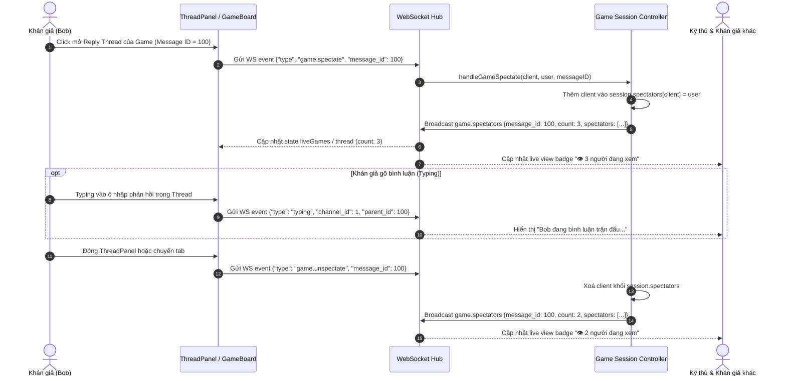

# Đặc Tả Kỹ Thuật (SPEC): Tính Năng Đếm Khán Giả Realtime & Spectator Presence Khi Xem/Bình Luận Game

- **Mã tính năng**: `LIVE-GAME-SPECTATORS`
- **Tác giả**: Antigravity (DeepMind Team)
- **Trạng thái**: ✅ Đã triển khai (Implemented & Verified)
- **Ngày tạo**: 2026-11-20
- **Thư mục liên quan**:
  - Backend: `controller/games.go`, `controller/socket.go`, `socket/main.go`
  - Frontend: `desktop/src/components/ThreadPanel.tsx`, `desktop/src/components/LiveGamesBar.tsx`, `desktop/src/components/Games.tsx`, `desktop/src/state/`

---

## 1. Mục Tiêu & Phạm Vi (Goals & Scope)

### 1.1 Mục tiêu (Goals)
1. **Theo dõi khán giả thời gian thực (Real-time Spectator Presence)**: Khi một ván game đang diễn ra (`status == "playing"`), người dùng click vào xem ván đấu, mở reply thread của ván đấu, hoặc typing bình luận trong reply thread sẽ được ghi nhận là một khán giả (Spectator) đang theo dõi trận đấu.
2. **Hiển thị số lượng và danh sách người xem**:
   - Cập nhật tức thời số lượng người xem trực tiếp (`👁️ X người đang xem`) trên:
     - Header của `ThreadPanel` (bình luận trận đấu).
     - Thẻ ván đấu trên thanh `LiveGamesBar` (Topbar kênh chat).
     - Khu vực thông tin bàn cờ (`Games.tsx`, `XiangqiGame.tsx`).
   - Hiển thị danh sách avatar / tooltip tên của các khán giả đang có mặt.
3. **Cơ chế dọn dẹp tức thời**: Khi khán giả đóng panel thread, chuyển sang xem kênh/thread khác hoặc mất kết nối socket (`clientGone`), server tự động huỷ tư cách khán giả và broadcast lại số lượng mới mà không bị leak bộ nhớ.

### 1.2 Không thuộc phạm vi (Non-Goals)
- Không bắt buộc người chỉ lướt qua tin nhắn trên dòng chat chính phải kết nối spectator (chỉ tính khi chủ động click/mở reply thread hoặc tương tác với ván đấu).
- Không giới hạn số lượng khán giả tối đa xem một trận đấu.

---

## 2. Kiến Trúc & Luồng Hoạt Động (Architecture & Flow)

### 2.1 Luồng Tương Tác Giữa Client & Server (Sequence Diagram)



### 2.2 Vòng đời của Spectator trong Game Session
- **Join (Tham gia)**:
  - Trigger: Mở `ThreadPanel` của tin nhắn chứa game embed, hoặc click vào nút "Xem ván đấu" trên `LiveGamesBar`, hoặc focus/typing vào ô chat reply của ván đấu.
  - Action: Client gửi WebSocket request `game.spectate` với `message_id`.
- **Heartbeat / Active Connection**:
  - Trạng thái khán giả gắn liền với vòng đời của `*socket.Client`.
- **Leave (Rời khỏi)**:
  - Chủ động: Component unmount / người dùng đóng `ThreadPanel` -> gửi `game.unspectate`.
  - Bị động: WebSocket disconnect / reload trang -> hook `clientGone` quét và dọn dẹp toàn bộ phòng spectator mà client đó từng tham gia.

---

## 3. Mô Hình Dữ Liệu & API Contracts

### 3.1 Dữ Liệu Bộ Nhớ Server (`controller/games.go`)

```go
type SpectatorInfo struct {
    UserID      int64   `json:"user_id"`
    Username    string  `json:"username"`
    DisplayName string  `json:"display_name"`
    Avatar      *string `json:"avatar"`
}

type gameSession struct {
    messageID   int64
    channelID   int64
    g           game.Game
    mu          sync.Mutex
    running     bool
    deleted     bool
    watchers    map[*socket.Client]bool          // Cho game thời gian thực (Station)
    spectators  map[*socket.Client]SpectatorInfo // Khán giả đang xem thread/ván đấu
}
```

### 3.2 WebSocket Request Payloads (Client -> Server)

1. **Khán giả bắt đầu theo dõi trận đấu**:
```json
{
  "type": "game.spectate",
  "message_id": 1024
}
```

2. **Khán giả rời khỏi trận đấu**:
```json
{
  "type": "game.unspectate",
  "message_id": 1024
}
```

### 3.3 WebSocket Event Payloads (Server -> Channel / Clients)

**Sự kiện cập nhật danh sách khán giả (`game.spectators`)**:
```json
{
  "type": "game.spectators",
  "message_id": 1024,
  "channel_id": 1,
  "count": 3,
  "spectators": [
    {
      "user_id": 5,
      "username": "bob",
      "display_name": "Bob Đẹp Trai",
      "avatar": "/uploads/avatars/bob.png"
    },
    {
      "user_id": 7,
      "username": "charlie",
      "display_name": "Charlie Cờ Thủ",
      "avatar": null
    }
  ]
}
```

---

## 4. Quy Tắc Nghiệp Vụ & Xử Lý Trường Hợp Biên (Domain Rules & Edge Cases)

| Kịch bản / Trường hợp biên | Cách thức xử lý |
|:---|:---|
| 1. Kỳ thủ trong trận mở thread của chính mình | Vẫn được tính trong danh sách khán giả/người theo dõi thread hoặc có thể hiển thị badge phân biệt giữa Kỳ thủ & Khán giả. Đếm theo distinct `user_id` để 1 người mở 2 tab không bị đếm x2. |
| 2. Mạng giật / F5 / Đóng trình duyệt đột ngột | Hook `clientGone` trong `socket.go` / `games.go` tự động xoá client khỏi mọi `session.spectators` và broadcast lại count tức thì. |
| 3. Ván đấu kết thúc (`status == "ended"`) | Vẫn cho phép khán giả xem kết quả và bình luận, nhưng badge chuyển trạng thái "Đã kết thúc" và ngừng đếm khi thread đóng. |
| 4. Nhiều người cùng tham gia / rời khỏi cùng lúc | Bảo vệ `session.mu.Lock()` đảm bảo thread-safe, không race condition. |
| 5. Tin nhắn game bị xoá | Khi tin nhắn bị xoá, `s.deleted = true`, huỷ toàn bộ spectator map và không broadcast thêm. |

---

## 5. Thiết Kế Giao Diện Người Dùng (UI / UX)

### 5.1 Vị trí hiển thị
1. **LiveGamesBar (Thanh topbar ghim ván cờ)**:
   - Hiển thị badge nhỏ gọn bên cạnh tên trận đấu:
     `👁️ 3` với tooltip hiển thị danh sách người đang xem ("Bob, Charlie và 1 người khác").
2. **ThreadPanel Header**:
   - Bên dưới tiêu đề "Bình luận trận đấu #1024":
     Thêm thanh trạng thái live: `[LIVE 🔴] 3 khán giả đang xem` cùng avatar stack thu nhỏ.
3. **Bàn Cờ (XiangqiGame.tsx / Games.tsx)**:
   - Một thanh widget góc trên bàn cờ hiển thị số lượng khán giả đang theo dõi trực tiếp.

### 5.2 Hiệu ứng tương tác
- Khi số lượng người xem tăng: Badge có animation scale nhẹ `scale(1.15)` trong 0.3s.
- Tooltip hiển thị đầy đủ tên hiển thị của các khán giả khi rê chuột vào biểu tượng con mắt.

---

## 6. Kế Hoạch Triển Khai Từng Bước (Implementation Checklist)

- [x] **Giai đoạn 1: Backend Spectator Session Management**
  - [x] Thêm `spectators map[*socket.Client]SpectatorInfo` vào `gameSession` trong [controller/games.go](file:///Users/hoang.nguyen3/tidebird/chat/controller/games.go).
  - [x] Implement handler `game.spectate` và `game.unspectate` trong `controller/games.go` và router `controller/socket.go`.
  - [x] Tích hợp dọn dẹp spectator trong `clientGone` khi WebSocket đóng.
  - [x] Viết unit tests kiểm thử backend trong `controller/games_test.go`: test spectate, unwatch, broadcast count, deduplicate user ID.
- [x] **Giai đoạn 2: Frontend State & WebSocket Sync**
  - [x] Cập nhật socket listener nhận event `game.spectators` trong [desktop/src/state/ChatProvider.tsx](file:///Users/hoang.nguyen3/tidebird/chat/desktop/src/state/ChatProvider.tsx).
  - [x] Thêm `spectators` map hoặc lưu vào `LiveGameSummary` trong [desktop/src/state/chat.ts](file:///Users/hoang.nguyen3/tidebird/chat/desktop/src/state/chat.ts).
  - [x] Gửi `game.spectate` khi mount / mở `ThreadPanel` của tin nhắn game và gửi `game.unspectate` khi unmount.
- [x] **Giai đoạn 3: UI Enhancements & Layout**
  - [x] Hiển thị spectator badge trên [desktop/src/components/LiveGamesBar.tsx](file:///Users/hoang.nguyen3/tidebird/chat/desktop/src/components/LiveGamesBar.tsx).
  - [x] Hiển thị khán giả header trên [desktop/src/components/ThreadPanel.tsx](file:///Users/hoang.nguyen3/tidebird/chat/desktop/src/components/ThreadPanel.tsx).
  - [x] Thêm CSS styling, avatar stack và tooltip không vi phạm vendor prefix hay clipping.
- [x] **Giai đoạn 4: Kiểm Thử & Xác Nhận Chất Lượng**
  - [x] Chạy `go test ./...`.
  - [x] Chạy `pnpm build`.
  - [x] Chạy `make verify` pass 5/5 tiêu chí.
